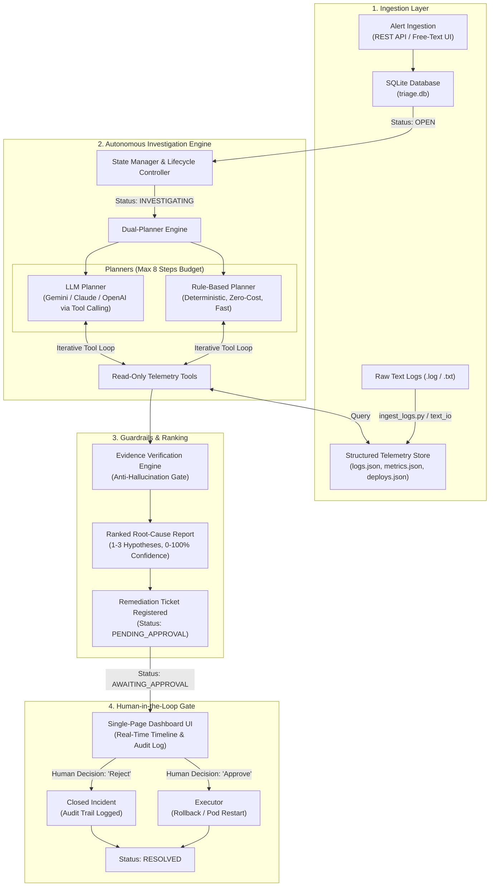

# Autonomous Incident Triage & Root-Cause Platform
### Technical Architecture, Core Mechanisms, and Operational Guide

---

## 1. Executive Summary & Central Idea

During production software outages, Site Reliability Engineers (SREs) and on-call developers face a high-stress diagnostic hurdle: **correlating metric spikes across distributed dashboards, sifting through millions of noisy text logs, and reviewing recent code deployments—all while Mean Time To Resolution (MTTR) ticks away.**

### The Flaw with Naive AI Approaches
Dumping gigabytes of raw production telemetry into a single Large Language Model (LLM) prompt is fundamentally flawed:
* **Token context window limits & high API latency**
* **Hallucination of non-existent causes**
* **Blaming the latest deploy on timing alone**, falling for innocent "decoy" deploys
* **Lack of safety guardrails**, risking accidental automated actions on live production clusters

### The Platform's Core Principle
This project implements an **Autonomous, State-Driven Incident Triage Platform**—not a fragile one-shot script. It operates like an experienced on-call engineer:
1. **Paces its investigation iteratively** using narrow, read-only telemetry tools.
2. **Follows dependency breadcrumbs** (e.g., recognizing when an API Gateway crash is merely a symptom of a downstream database pool exhaustion).
3. **Correlates error signatures with code commit messages** to filter out innocent decoy deploys.
4. **Verifies and quotes verbatim evidence** (metrics, log stack traces, and commit diffs).
5. **Enforces a strict Human-in-the-Loop Safety Gate**: it registers a recommended remediation as `PENDING_APPROVAL` and never executes actions until an authorized human clicks **Approve**.

---

## 2. End-to-End System Architecture



---

## 3. Explicit 4-Stage Lifecycle State Machine

Incidents move through deterministic states stored in SQLite (`triage.db`):

| State | Description | Transition Trigger |
|---|---|---|
| **`OPEN`** | Alert received and registered in the database. | `POST /api/alerts` or `POST /api/alerts/text` |
| **`INVESTIGATING`** | Agent active in its iterative tool-calling loop (capped at 8 steps). | Background task worker begins triage |
| **`AWAITING_APPROVAL`** | Root cause identified, evidence ranked, and fix ticket proposed. | Agent finishes analysis and calls `propose_remediation` |
| **`RESOLVED`** | Human reviewed the evidence and clicked **Approve** or **Reject**. | `POST /api/incidents/{id}/approve` |

---

## 4. How It Works: The Investigation Engine

### 4.1. The Read-Only Tool Suite
The agent cannot see the whole universe at once. It must query narrow tools:

1. **`get_metrics(service, window)`**:
   * Evaluates time-series CPU, memory, p99 latency, and 5xx error percentages over a time window.
   * Compares recent windows against baselines to establish anomaly onset timestamps.
2. **`search_logs(service, query, level, limit, window)`**:
   * Narrow regex search over application logs matching specific error signatures (e.g. `Connection pool exhausted`, `OutOfMemoryError`).
   * Extracts exact timestamps, trace IDs, and stack traces.
3. **`list_deploys(service, limit)`**:
   * Retrieves chronological commit histories, authors, versions, and change descriptions prior to onset.
4. **`propose_remediation(action, target)`**:
   * Registers a proposed operational action (`rollback_deploy`, `restart_pod`, `scale_up`).
   * **Crucial constraint**: It never executes. It returns a ticket ID awaiting human approval.

---

### 4.2. Dual-Planner Architecture
The system supports two interchangeable reasoning backends behind identical tool schemas:

* **Rule-Based Planner (Default)**:
  * Deterministic graph analysis: follows upstream traces when errors indicate dependencies, evaluates metric onset times, and calculates textual overlap between commit messages and error logs.
  * Fast (sub-second), completely reproducible, and requires zero external API keys or cloud dependencies.
* **LLM Planner (Optional / Auto-Detected)**:
  * Leverages Google Gemini (`gemini-3.8-flash`), Anthropic Claude (`claude-sonnet-5-5`), or OpenAI/Groq via standard function-calling protocols.
  * Reasons dynamically over tool outputs.
  * **Anti-Hallucination Guardrail**: The backend cross-checks the LLM's final report against the actual strings returned by the tools. Any evidence the tools never saw is dropped automatically.

---

## 5. Key Engineering Solvers & Planted Scenarios

The platform is evaluated across 6 production failure patterns:

| Scenario | Challenging Dynamic | How the Agent Solves It |
|---|---|---|
| **Payment 5xx Spike** | **Decoy Deploy Trap**: An innocent deploy (`v2.14.1`) landed 2 minutes before the crash; the culprit (`v2.14.0`) landed 15 minutes earlier. | Cross-references error terms (`pool`, `size`, `Hikari`) with commit messages. Blames `v2.14.0` ("Reduced DB_POOL_SIZE") and exonerates the decoy. |
| **Gateway 5xx** | **Cascading Dependency Failure**: Alerts fire on `api-gateway`, but the root cause is downstream. | Parses gateway error logs, identifies `upstream payment-service returned 503`, hops to `payment-service`, and blames the upstream root cause. |
| **Order OOM** | **Delayed-Onset Memory Leak**: Memory climbs slowly; container crashes long after deploy. | Scans deploys within a 120-minute lookback window, identifies `v4.2.0` ("in-memory cache buffer preallocation"), and ignores the `v4.2.1` UI styling decoy. |
| **Database Saturation** | **Operational Failure (No Code Cause)**: Memory leak without any recent deployment. | Confirms no recent deploy matches the error, identifies resource exhaustion, and proposes `restart_pod` rather than an ineffective rollback. |
| **Email Outage** | **External Vendor Outage**: Outage caused by third-party provider (SendGrid 503 rate-limit). | Identifies external provider signatures, flags verdict as `NO_CODE_CAUSE`, and proposes **no rollback** (escalate to vendor). |
| **Auth Latency Blip** | **Transient Noise**: Brief p99 latency blip with zero error logs. | Observes no corroborating error logs; reports `INSUFFICIENT_EVIDENCE` rather than fabricating a false alarm. |

---

## 6. Plain-Text Log Ingestion Pipeline

In real production environments, telemetry does not originate as neat JSON objects. The platform includes a log ingestion engine:

```text
Raw Log Stream (.txt / .log)
  │
  ├──> Standard Format:      "2026-11-23T09:45:30 ERROR payment-service Connection timeout (trace_id=tr-123)"
  ├──> Bracketed Format:     "[2026-11-23 09:45:30] [ERROR] [payment-service] Connection timeout"
  ├──> Multi-Line Traces:    "java.lang.OutOfMemoryError: Java heap space\n    at com.example.service..."
  └──> JSON Lines (NDJSON):  {"ts": "...", "level": "ERROR", "service": "...", "message": "..."}
  │
  ▼
[backend/text_io.py] & [backend/ingest_logs.py]
  │
  ▼
Structured Local Cache (backend/data/logs.json)
```

### Ingestion CLI Commands:
```powershell
# 1. Ingest default text logs:
python ingest_logs.py

# 2. Ingest custom server logs:
python ingest_logs.py /path/to/production.log

# 3. Merge new log files without overwriting:
python ingest_logs.py --merge /path/to/additional.log
```

---

## 7. Verification & Benchmarking

The codebase includes an automated benchmark suite ([`backend/evaluate.py`](file:///c:/Users/Life_Walker/Desktop/Folder/internship_test/triage-agent/backend/evaluate.py)) that scores the agent against a naive industry baseline policy (*"always blame the most recent deploy"*):

### Benchmark Output:
```text
scenario               verdict                target                     steps conf  result
payment-service        ROOT_CAUSE_FOUND       payment-service@v2.14.0      5     95  PASS  [rules]
api-gateway            ROOT_CAUSE_FOUND       payment-service@v2.14.0      8     95  PASS  [rules]
order-service          ROOT_CAUSE_FOUND       order-service@v4.2.0         5     90  PASS  [rules]
database               ROOT_CAUSE_FOUND       database                     5     75  PASS  [rules]
notification-service   NO_CODE_CAUSE          None                         4     75  PASS  [rules]
auth-service           INSUFFICIENT_EVIDENCE  None                         4      -  PASS  [rules]

Agent                            pass 6/6  decoy hits 0  mean graded reward 1.00
Baseline (blame latest deploy)   pass 2/6  decoy hits 2  mean graded reward 0.42
```

* **Agent Accuracy**: **100% (6/6 PASS)**
* **Decoy Avoidance**: **0 decoy hits** (Baseline fell for decoys twice)
* **Mean Graded Reward**: **1.00 vs 0.42**

---

## 8. Summary of Components & Directory Map

```text
internship_test/
├── triage-agent/
│   ├── backend/
│   │   ├── agent.py            # Bounded agent loop, tools, and dual-planner logic
│   │   ├── db.py               # SQLite schema, state transitions, and audit trail
│   │   ├── evaluate.py         # 6-scenario benchmark vs naive baseline
│   │   ├── gen_data.py         # Multi-service telemetry generator (metrics, logs, deploys)
│   │   ├── ingest_logs.py      # Plain-text (.log/.txt) CLI ingestion utility
│   │   ├── main.py             # FastAPI REST endpoints & static file server
│   │   ├── text_io.py          # Log normalization, regex parsers, and incident formatters
│   │   ├── data/               # Persistent JSON & raw TXT telemetry datasets
│   │   └── static/
│   │       └── index.html      # Single-page web dashboard (timeline, reports, approvals)
│   ├── requirements.txt        # Runtime dependencies (FastAPI, Uvicorn, Pydantic)
│   └── README.md               # Quickstart guide and API reference
```
